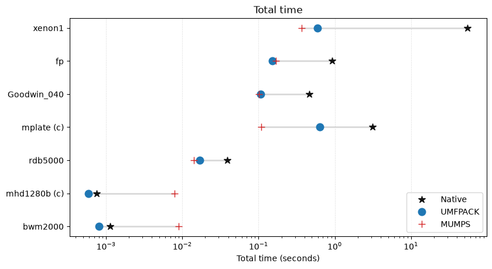
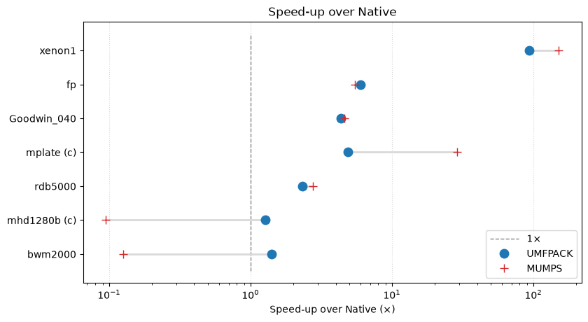
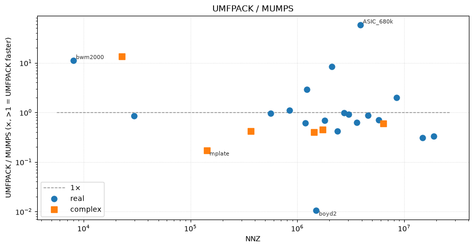

# Performance benchmarks using the Rust Scientific Library (Russell) <!-- omit from toc --> 

## Contents <!-- omit from toc --> 

- [Introduction](#introduction)
- [Solvers for large sparse linear systems](#solvers-for-large-sparse-linear-systems)
- [Results](#results)
  - [Direct at a glance](#direct-at-a-glance)
  - [Information about the tested matrices](#information-about-the-tested-matrices)
  - [Calculations on Arch. Direct, UMFPACK and MUMPS. Real-valued matrices.](#calculations-on-arch-direct-umfpack-and-mumps-real-valued-matrices)
  - [Calculations on Arch. Direct, UMFPACK and MUMPS. Complex-valued matrices.](#calculations-on-arch-direct-umfpack-and-mumps-complex-valued-matrices)
  - [Calculations on Arch. UMFPACK compared with the iterative solvers. Real-valued matrices.](#calculations-on-arch-umfpack-compared-with-the-iterative-solvers-real-valued-matrices)
  - [Legacy results](#legacy-results)
- [System and libraries information](#system-and-libraries-information)


## Introduction

This project contains performance benchmarks using the [Rust Scientific Library (Russell)](https://github.com/cpmech/russell).

We compare the sparse linear solvers from [russell_sparse](https://github.com/cpmech/russell/tree/main/russell_sparse): the pure-Rust **Direct** solver (the default in Russell 5.0), **UMFPACK**, and **MUMPS**; and, in their own table, the pure-Rust iterative solvers — **BiCGStab** and **GMRES** on the algebraic-multigrid preconditioner — against UMFPACK.

The direct results for the SuiteSparse matrices were produced with `russell_sparse` 4.1 (with `algebra_linear` 1.2) and migrated to the 5.0 statistics schema rather than re-measured. The iterative results, and every result for `pmsim-hex8-27`, were measured for this version: `russell_sparse` 5.0 with `algebra_linear` 2.1, features `intel_mkl`, `umfpack` and `mumps`, so UMFPACK and MUMPS are linked against the local Intel MKL. See the [system and libraries information](#system-and-libraries-information) used in the benchmarks.

The iterative solvers are a limited backend and the tables show it: with the default AMG settings they converge on a minority of the matrices, and an `n/a` there means the iteration did not reach the requested tolerance (or the run hit the memory cap), not that it was skipped. For production work, the direct backends are the ones to use.

The cuDSS and KLU results from the earlier Russell 2.8 benchmark are kept under [`results/legacy-2.8/`](results/legacy-2.8) for reference; they are not part of the current comparison.


## Solvers for large sparse linear systems

- **Direct** — the pure-Rust LU factorization from [`algebra_linear`](https://github.com/cpmech/algebra_linear), with COLAMD ordering, partial pivoting, and a simplicial/supernodal choice made by a flop proxy. It requires no external library.
- **UMFPACK** — the unsymmetric multifrontal solver from [SuiteSparse](https://github.com/DrTimothyAldenDavis/SuiteSparse).
- **MUMPS** — the multifrontal massively parallel sparse direct solver ([mumps-solver.org](https://mumps-solver.org/index.php)).

The results are available in PDF format and also listed below.

* [Arch Linux. Results PDF file](results/arch-performance-tables.pdf)

We test the linear system **Ax = b** where **A** is the coefficient matrix, **x** is the solution vector, and **b** is the right-hand side vector. The coefficient matrix is set with matrices from the [SuiteSparse Matrix Collection](https://sparse.tamu.edu). The right-hand side vector is filled with ones, i.e., we study the solution of

**A x = 1**

The relative error is calculated as

```text
RelativeError = max(|A x - 1|) / max(|A| + 1)
```

The real-valued tested matrices are:

 1. **bwm2000** (Bai) -- Brusselator wave model in transport interaction of chemical solutions (1992)
 2. **rdb5000** (Bai) -- Reaction-diffusion brusselator model (1994)
 3. **Goodwin_040** (Goodwin) -- Finite element, Navier-Stokes & other transport equations (2018)
 4. **fp** (MKS) -- 2-D Fokker Planck eqn, electron dyn. in external field (2006)
 5. **xenon1** (Ronis) -- Complex zeolite, sodalite crystals (2001)
 6. **twotone** (ATandT) -- Harmonic balance method (2001)
 7. **Raj1** (Rajat) -- Circuit Simulation Problem (2007)
 8. **boyd2** (GHS_indef) -- Optimization problem (2004)
 9. **Goodwin_071** (Goodwin) -- Finite element, Navier-Stokes & other transport equations (2018)
 10. **darcy003** (GHS_indef) -- Discretization using mixed FE of Darcy (2002)
 11. **rma10** (Bova) -- 3D CFD model, Charleston harbor (1997)
 12. **helm2d03** (GHS_indef) -- Helmholtz eq on a unit square (2004)
 13. **stomach** (Norris) -- 3D electro-physical model of a duodenum (2003)
 14. **oilpan** (GHS_psdef) -- Structural problem (2004)
 15. **ASIC_680k** (Sandia) -- Circuit simulation matrix (2006)
 16. **tmt_unsym** (CEMW) -- Electromagnetics problem (2008)
 17. **Goodwin_127** (Goodwin) -- Finite element, Navier-Stokes & other transport equations (2018)
 18. **pre2** (ATandT) -- Harmonic balance method (2001)
 19. **marine1** (Martin) -- Chemical oceanography; a marine nitrogen cycle inverse model (2018)
 20. **torso1** (Norris) -- Finite differences and boundary element, 2D model of torso (2003)
 21. **atmosmodd** (Bourchtein) -- CFD analysis of atmospheric models (2009)
 22. **atmosmodl** (Bourchtein) -- CFD analysis of atmospheric models (2009)
 23. **memchip** (Freescale) -- Circuit simulation problem (2010)
 24. **Freescale1** (Freescale) -- Circuit simulation problem (2008)
 25. **rajat31** (Rajat) -- Circuit simulation problem (2006)
 26. **Transport** (Janna) -- 3D finite element flow and transport (2012)
 27. **inline_1** (GHS_psdef) -- Structural problem, stiffness matrix (2004)
 28. **PFlow_742** (Janna) -- 3D pressure-temperature evolution in porous media (2014)
 29. **Emilia_923** (Janna) -- Geomechanical model for C02 sequestration (2011)
 30. **dielFilterV2real** (Dziekonski) -- FEM in electromagnetics (2011)
 31. **Flan_1565** (Janna) -- Structural problem, 3D model of a steel flange (2011)
 32. **pres-cylin** (Pedroso) -- FEM stiffness matrix of a pressurized cylinder (Tet10 with 1,711,464 DOF). Not from the Collection. From [Pedroso DM (2024) Caveats of three direct linear solvers for finite element analyses](https://onlinelibrary.wiley.com/doi/10.1002/nme.7545).

The complex-valued tested matrices are:

1. **mhd1280b** (Bai) -- Alfven spectra in magnetohydrodynamics (1994)
2. **mplate** (Cote) -- Vibro-acoustic problem (1997)
3. **RFdevice** (Rost) -- Semiconductor device simulation (2007)
4. **vfem** (CEMW) -- Electromagnetics, vector finite element (2008)
5. **fem_filter** (Lee) -- FEM band-pass microwave filter 500MHz (2008)
6. **Chevron4** (Chevron) -- Temporal freq domain seismic modeling (2012)
7. **mono_500Hz** (FreeFieldTechnologies) -- 3D vibro-acoustic problem, aircraft engine nacelle (2008)
8. **kim2** (Kim) -- 2D 676-by-676 complex mesh (2002)
9. **fem_hifreq_circuit** (Lee) -- FEM Maxwell equations for hi-freq circuit (2009)
10. **dielFilterV3clx** (Dziekonski) -- High-order vector finite element method in EM (2011)

**Additional notes:**

1. Each problem is solved five times. The reported error is the maximum among runs. The reported computer time is the average without outliers. The Direct solver uses five runs for fast matrices, three for slower ones, and a single probe run for the rest.
2. Total time includes initialization (memory allocation + symbolic factorization), numeric factorization, and solve.
3. Column NNZ (number of non-zeros) corresponds to Pattern Entries reported by the [SuiteSparse Matrix Collection](https://sparse.tamu.edu).
4. Column Sym shows if symmetry information was provided to the solver. An asterisk means positive definite information was also given.
5. oom (out-of-memory) indicates that the symbolic factorization was terminated due to insufficient memory.
6. n/a indicates that the run was not attempted, or that the Direct solver exceeded its probe budget. The results shown here used a five-minute budget; the runner now defaults to three minutes.
7. Bold values highlight significant results, such as large errors or high computation times.
8. The Direct solver is pure Rust; it does not compute determinants, error estimates or condition numbers.


## Results

### Direct at a glance

The pure-Rust Direct solver completed on the following matrices. The last two columns show how much faster UMFPACK and MUMPS are (where MUMPS is slower than Direct, the entry says so):

| Matrix | Direct | UMFPACK | MUMPS | UMFPACK / Direct | MUMPS / Direct |
| --- | ---: | ---: | ---: | ---: | ---: |
| bwm2000 | 1.11 ms | 0.750 ms | 6.05 ms | 1.47× faster | 5.47× slower |
| rdb5000 | 39.0 ms | 13.6 ms | 9.95 ms | 2.88× faster | 3.92× faster |
| Goodwin_040 | 449 ms | 107 ms | 105 ms | 4.19× faster | 4.29× faster |
| fp | 904 ms | 154 ms | 169 ms | 5.85× faster | 5.35× faster |
| xenon1 | 55.2 s | 598 ms | 365 ms | 92× faster | 151× faster |
| mhd1280b | 0.717 ms | 0.383 ms | 5.76 ms | 1.87× faster | 8.03× slower |
| mplate | 3.13 s | 627 ms | 109 ms | 4.99× faster | 28.7× faster |

The remaining matrices, including `RFdevice`, exceeded the Direct probe budget (see the notes above). The Direct rows use the simplicial path; the four supernodal results were produced with `LinSolParams::direct_supernodal` and are kept under [`results/arch/direct-supernodal/`](results/arch/direct-supernodal).

Total time per matrix on a log scale, sorted by NNZ (`(c)` marks a complex-valued matrix):



Speed-up over Direct (`>1` means faster than Direct; the dashed line is parity):



UMFPACK / MUMPS speed-up for every matrix where both solvers completed (25 of 42; UMFPACK runs out of memory on the remaining matrices). Values above 1 mean UMFPACK is faster; below 1, MUMPS is faster:



The Direct solver is fast on small systems: up to about 30,000 non-zeros it takes at most a few tens of milliseconds. It becomes very slow for matrices with more than **1 million** non-zeros: the `xenon1` case (NROW=48,600, 1,181,120 non-zeros) takes **55 s**, and the next real case (`twotone`, NROW=120,750, 1,224,224 non-zeros) did not finish within the 3-minute probe. For matrices with more than **1 million** non-zeros, expect **nearly a minute** or more.

The threshold is not a function of NNZ alone. The complex `mplate` (NROW=5,962, 142,190 non-zeros) takes **3.13 s**, and `RFdevice` (NROW=74,104, 365,580 non-zeros) did not finish in **15 minutes**; sparsity structure and numerical type matter as much as the non-zero count.

### Information about the tested matrices


**Real-valued matrices:**
| Matrix | Nrow | NNZ | Sym |
| --- | ---: | ---: | :-: |
| bwm2000 | 2,000 | 7,996 | No |
| rdb5000 | 5,000 | 29,600 | No |
| Goodwin_040 | 17,922 | 561,677 | No |
| fp | 7,548 | 848,553 | No |
| xenon1 | 48,600 | 1,181,120 | No |
| twotone | 120,750 | 1,224,224 | No |
| Raj1 | 263,743 | 1,302,464 | No |
| boyd2 | 466,316 | 1,500,397 | Yes |
| Goodwin_071 | 56,021 | 1,797,934 | No |
| darcy003 | 389,874 | 2,101,242 | Yes |
| rma10 | 46,835 | 2,374,001 | No |
| helm2d03 | 392,257 | 2,741,935 | Yes |
| stomach | 213,360 | 3,021,648 | No |
| oilpan | 73,752 | 3,597,188 | Yes* |
| ASIC_680k | 682,862 | 3,871,773 | No |
| tmt_unsym | 917,825 | 4,584,801 | No |
| Goodwin_127 | 178,437 | 5,778,545 | No |
| pre2 | 659,033 | 5,959,282 | No |
| marine1 | 400,320 | 6,226,538 | No |
| torso1 | 116,158 | 8,516,500 | No |
| atmosmodd | 1,270,432 | 8,814,880 | No |
| atmosmodl | 1,489,752 | 10,319,760 | No |
| memchip | 2,707,524 | 14,810,202 | No |
| Freescale1 | 3,428,755 | 18,920,347 | No |
| rajat31 | 4,690,002 | 20,316,253 | No |
| Transport | 1,602,111 | 23,500,731 | No |
| inline_1 | 503,712 | 36,816,342 | Yes* |
| PFlow_742 | 742,793 | 37,138,461 | Yes* |
| Emilia_923 | 923,136 | 41,005,206 | Yes* |
| dielFilterV2 | 1,157,456 | 48,538,952 | Yes |
| Flan_1565 | 1,564,794 | 117,406,044 | Yes* |
| pres-cylin | 1,711,464 | 133,562,188 | Yes* |
| pmsim-hex8-27 | 157 | 6,581 | Yes* |

**Complex-valued matrices:**
| Matrix | Nrow | NNZ | Sym |
| --- | ---: | ---: | :-: |
| mhd1280b | 1,280 | 22,778 | No |
| mplate | 5,962 | 142,190 | Yes |
| RFdevice | 74,104 | 365,580 | No |
| vfem | 93,476 | 1,434,636 | No |
| fem_filter | 74,062 | 1,731,206 | No |
| Chevron4 | 711,450 | 6,376,412 | No |
| mono_500Hz | 169,410 | 5,036,288 | No |
| kim2 | 456,976 | 11,330,020 | No |
| fem_hifreq_circuit | 491,100 | 20,239,237 | No |
| dielFilterV3clx | 420,408 | 32,886,208 | Yes |

... direct: 6 measured matrices, run counts [5]
... umfpack: 20 measured matrices, run counts [5]
... mumps: 33 measured matrices, run counts [5]
... direct: 2 measured matrices, run counts [5]
... umfpack: 6 measured matrices, run counts [5]
... mumps: 10 measured matrices, run counts [5]

### Calculations on Arch. Direct, UMFPACK and MUMPS. Real-valued matrices.


| Matrix | Direct Time | Direct Error | UMFPACK Time | UMFPACK Error | MUMPS Time | MUMPS Error |
| --- | ---: | ---: | ---: | ---: | ---: | ---: |
| bwm2000 | 1.106ms | 1.48e-15 | 750.259µs | 5.30e-16 | 6.054ms | 7.50e-16 |
| rdb5000 | 39.034ms | 1.01e-14 | 13.569ms | 1.93e-15 | 9.946ms | 9.40e-13 |
| Goodwin_040 | 448.636ms | 9.71e-12 | 107.091ms | 6.62e-13 | 104.564ms | 1.65e-11 |
| fp | 903.691ms | 4.88e-20 | 154.476ms | 2.57e-21 | 168.911ms | 1.16e-20 |
| xenon1 | 55.233s | 1.19e-38 | 598.244ms | 5.55e-40 | 365.443ms | 5.86e-40 |
| twotone | n/a | n/a | 337.133ms | 1.13e-14 | 983.724ms | 1.99e-13 |
| Raj1 | n/a | n/a | oom | oom | 947.420ms | 3.63e-13 |
| boyd2 | n/a | n/a | **1m18.248s** | 2.86e-13 | 844.848ms | 8.98e-11 |
| Goodwin_071 | n/a | n/a | 426.060ms | 2.77e-12 | 290.877ms | 4.87e-11 |
| darcy003 | n/a | n/a | 1.385s | 6.95e-12 | 11.601s | 1.88e-10 |
| rma10 | n/a | n/a | 410.052ms | 1.57e-17 | 169.806ms | 1.35e-16 |
| helm2d03 | n/a | n/a | 1.683s | 2.37e-13 | 1.573s | 2.75e-10 |
| stomach | n/a | n/a | 1.781s | 5.13e-16 | 1.720s | 1.49e-15 |
| oilpan | n/a | n/a | 494.931ms | 1.26e-15 | 305.492ms | 2.05e-15 |
| ASIC_680k | n/a | n/a | 1.318s | 2.20e-11 | **1m19.532s** | 8.09e-11 |
| tmt_unsym | n/a | n/a | 3.747s | 5.96e-8 | 3.289s | 1.43e-7 |
| Goodwin_127 | n/a | n/a | 1.173s | 6.03e-12 | 884.040ms | 8.89e-10 |
| pre2 | n/a | n/a | oom | oom | 5.102s | 2.85e-14 |
| marine1 | n/a | n/a | oom | oom | 5.627s | 6.25e-14 |
| torso1 | n/a | n/a | 952.952ms | 3.82e-8 | 2.018s | **3.75e-6** |
| atmosmodd | n/a | n/a | oom | oom | 46.011s | 2.48e-16 |
| atmosmodl | n/a | n/a | oom | oom | 40.869s | 7.60e-18 |
| memchip | n/a | n/a | 26.259s | 2.04e-15 | 8.046s | 3.40e-15 |
| Freescale1 | n/a | n/a | 30.025s | 7.05e-10 | 10.174s | 7.05e-10 |
| rajat31 | n/a | n/a | oom | oom | 16.019s | 9.31e-15 |
| Transport | n/a | n/a | oom | oom | 43.495s | 3.81e-10 |
| inline_1 | n/a | n/a | oom | oom | 3.584s | 2.77e-15 |
| PFlow_742 | n/a | n/a | oom | oom | 12.287s | 4.17e-11 |
| Emilia_923 | n/a | n/a | oom | oom | 39.852s | 5.27e-23 |
| dielFilterV2 | n/a | n/a | oom | oom | 13.788s | 1.45e-11 |
| Flan_1565 | n/a | n/a | oom | oom | 23.996s | 9.85e-16 |
| pres-cylin | n/a | n/a | oom | oom | **2m6.195s** | 4.90e-13 |
| pmsim-hex8-27 | 934.320µs | 1.16e-15 | 736.383µs | 2.85e-16 | 7.657ms | 5.62e-16 |

### Calculations on Arch. Direct, UMFPACK and MUMPS. Complex-valued matrices.


| Matrix | Direct Time | Direct Error | UMFPACK Time | UMFPACK Error | MUMPS Time | MUMPS Error |
| --- | ---: | ---: | ---: | ---: | ---: | ---: |
| mhd1280b | 717.206µs | 1.31e-15 | 382.531µs | 7.41e-16 | 5.759ms | 1.17e-15 |
| mplate | 3.131s | 4.66e-11 | 627.467ms | 1.86e-11 | 109.002ms | 6.28e-11 |
| RFdevice | n/a | n/a | 4.342s | 1.22e-13 | 1.803s | 1.52e-7 |
| vfem | n/a | n/a | 4.088s | 4.70e-8 | 1.638s | 6.54e-8 |
| fem_filter | n/a | n/a | 2.627s | 6.61e-11 | 1.185s | 1.40e-10 |
| Chevron4 | n/a | n/a | 5.729s | 1.60e-11 | 3.398s | 4.16e-11 |
| mono_500Hz | n/a | n/a | oom | oom | 6.379s | 5.64e-9 |
| kim2 | n/a | n/a | oom | oom | 4.745s | 2.73e-18 |
| fem_hifreq_circuit | n/a | n/a | oom | oom | 11.608s | 1.00e-10 |
| dielFilterV3clx | n/a | n/a | oom | oom | 4.824s | 1.68e-11 |

... umfpack: 20 measured matrices, run counts [5]
... bicgstab: 12 measured matrices, run counts [5]
... gmres: 7 measured matrices, run counts [5]

### Calculations on Arch. UMFPACK compared with the iterative solvers. Real-valued matrices.

| Matrix | UMFPACK Time | UMFPACK Error | BiCGStab Time | BiCGStab Error | GMRES Time | GMRES Error |
| --- | ---: | ---: | ---: | ---: | ---: | ---: |
| bwm2000 | 750.259µs | 5.30e-16 | 28.781ms | 8.72e-15 | n/a | n/a |
| rdb5000 | 13.569ms | 1.93e-15 | n/a | n/a | 25.734ms | 3.77e-12 |
| Goodwin_040 | 107.091ms | 6.62e-13 | 1.477s | 7.75e-10 | n/a | n/a |
| fp | 154.476ms | 2.57e-21 | n/a | n/a | n/a | n/a |
| xenon1 | 598.244ms | 5.55e-40 | 2.732s | 6.02e-38 | 2.935s | 1.18e-37 |
| twotone | 337.133ms | 1.13e-14 | n/a | n/a | n/a | n/a |
| Raj1 | oom | oom | n/a | n/a | n/a | n/a |
| boyd2 | **1m18.248s** | 2.86e-13 | n/a | n/a | n/a | n/a |
| Goodwin_071 | 426.060ms | 2.77e-12 | 11.724s | 7.92e-9 | n/a | n/a |
| darcy003 | 1.385s | 6.95e-12 | n/a | n/a | n/a | n/a |
| rma10 | 410.052ms | 1.57e-17 | n/a | n/a | n/a | n/a |
| helm2d03 | 1.683s | 2.37e-13 | n/a | n/a | n/a | n/a |
| stomach | 1.781s | 5.13e-16 | n/a | n/a | n/a | n/a |
| oilpan | 494.931ms | 1.26e-15 | n/a | n/a | n/a | n/a |
| ASIC_680k | 1.318s | 2.20e-11 | n/a | n/a | n/a | n/a |
| tmt_unsym | 3.747s | 5.96e-8 | 1.638s | 1.91e-7 | n/a | n/a |
| Goodwin_127 | 1.173s | 6.03e-12 | n/a | n/a | n/a | n/a |
| pre2 | oom | oom | n/a | n/a | n/a | n/a |
| marine1 | oom | oom | n/a | n/a | n/a | n/a |
| torso1 | 952.952ms | 3.82e-8 | n/a | n/a | n/a | n/a |
| atmosmodd | oom | oom | 7.780s | 7.66e-15 | 14.514s | 6.88e-15 |
| atmosmodl | oom | oom | 5.751s | 9.12e-16 | 7.781s | 1.59e-15 |
| memchip | 26.259s | 2.04e-15 | 21.341s | 1.73e-11 | 8.059s | 2.65e-11 |
| Freescale1 | 30.025s | 7.05e-10 | 7.383s | 1.64e-9 | n/a | n/a |
| rajat31 | oom | oom | 37.987s | 4.75e-12 | n/a | n/a |
| Transport | oom | oom | 6.315s | 1.90e-9 | 6.188s | 6.29e-10 |
| inline_1 | oom | oom | n/a | n/a | n/a | n/a |
| PFlow_742 | oom | oom | n/a | n/a | n/a | n/a |
| Emilia_923 | oom | oom | n/a | n/a | n/a | n/a |
| dielFilterV2 | oom | oom | n/a | n/a | n/a | n/a |
| Flan_1565 | oom | oom | n/a | n/a | n/a | n/a |
| pres-cylin | oom | oom | n/a | n/a | n/a | n/a |
| pmsim-hex8-27 | 736.383µs | 2.85e-16 | 818.326µs | 8.57e-14 | 736.254µs | 1.53e-13 |


The iterative columns are BiCGStab and GMRES on the AMG preconditioner, five runs each with the default settings. CG is not in the table because it requires a symmetric positive definite system and reaches the error gate on one matrix of the set. An `n/a` in an iterative column means the iteration did not reach 1e-10 within 1 000 iterations, or that the run was killed by the memory or time cap; it does not mean `not measured`.

### Legacy results

The results of the earlier Russell 2.8 benchmark are kept under [`results/legacy-2.8/`](results/legacy-2.8): the cuDSS, KLU, UMFPACK and MUMPS JSON files, and the two PDF files produced at the time. cuDSS and KLU are not part of Russell 4.0, so they are not compared here.

## System and libraries information

System information:

```
--- OS ---
NAME="Omarchy"
VERSION_ID="4.0.0.r7195.g3ac4365"
KERNEL=7.2.8-9-omarchy

--- GPU ---
03:00.0 VGA compatible controller: Advanced Micro Devices, Inc. [AMD/ATI] Navi 48 [Radeon RX 9070/9070 XT/9070 GRE] (rev c0)

--- CPU ---
Architecture       : x86_64
CPU(s)             : 32
On-line CPU(s) list: 0-31
Model name         : 13th Gen Intel(R) Core(TM) i9-13900KF
Thread(s) per core : 2
Core(s) per socket : 24
Socket(s)          : 1
CPU(s) scaling MHz : 44%
CPU max MHz        : 5800.0000
CPU min MHz        : 800.0000
BogoMIPS           : 5990.40
L1d cache          : 896 KiB (24 instances)
L1i cache          : 1.3 MiB (24 instances)
L2 cache           : 32 MiB (12 instances)
L3 cache           : 36 MiB (1 instance)
NUMA node0 CPU(s)  : 0-31
Vulnerability L1tf : Not affected

--- Memory ---
MemTotal:       32608344 kB
MemFree:        18586476 kB
MemAvailable:   24677040 kB
SwapTotal:      65224484 kB
```

Libraries information:

```
UMFPACK: local (/usr/local/lib/umfpack)
MUMPS: 5.9.0
SuiteSparse: latest (from GitHub)
```
